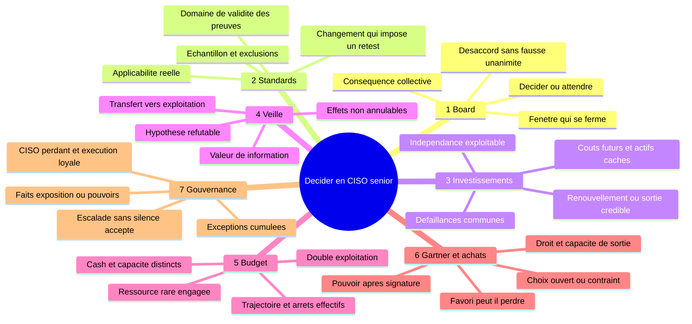
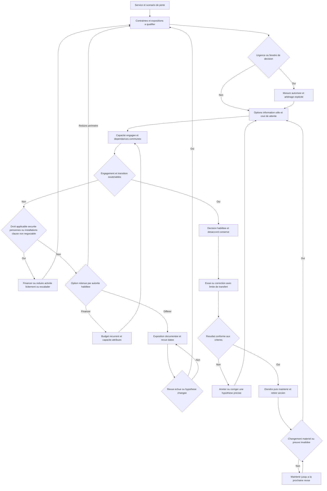

# Mind map — Ce qu’un CISO senior doit réellement arbitrer

- **Centre :** décider quand les bonnes raisons restent incompatibles.
- **Lecture :** chaque branche possède un dilemme distinct ; les liens transversaux montrent ce qui peut invalider une bonne décision locale.
- **Périmètre :** carte d’argumentation pour l’auteur, pas procédure de crise ni ordre automatique des achats.

## Trois fils, pas trois nouveaux chapitres

- **Fragilité collective :** chapitre 3 → arbitrage du chapitre 1 → revue des exceptions du chapitre 7. Des décisions locales défendables peuvent partager un point de rupture.
- **Temps et preuves :** chapitre 2 → expérience du chapitre 4 → trajectoire du chapitre 5. Un test peut rester récent et avoir perdu sa pertinence ; une cible rentable peut arriver trop tard.
- **Pouvoir réel :** chapitre 6 → chapitre 7 → décision du chapitre 1. Une sélection contrainte, une recommandation refusée et une autorité absente demandent des réponses différentes.

## Les tensions à garder visibles pendant la rédaction

- **1 ↔ 5 :** le budget approuvé ne confirme pas la disponibilité de l’équipe qui bloque plusieurs programmes.
- **2 ↔ 4 :** une preuve de pilote n’autorise pas toute extension ; un changement matériel peut invalider le résultat.
- **3 ↔ 5 :** économiser à destination peut exiger une transition que ni la trésorerie ni l’équipe ne peuvent absorber.
- **3 ↔ 6 :** diversifier les produits sans diversifier la dépendance commune peut ajouter de la charge sans préserver une capacité indépendante.
- **4 ↔ 7 :** le contrôle humain promis par l’innovation doit disposer d’informations, de temps et d’autorité réels.
- **6 ↔ 7 :** quand le choix fournisseur est contraint, faire approuver ses limites ; ne pas maquiller une préférence imposée en victoire technique.
- **Tous ↔ roadmap :** montrer ce qui commence, ce qui cesse et ce qui reste exposé pendant le passage.

## Carte de décision de la roadmap

## Si le décideur ne décide pas

- Les mesures urgentes autorisées partent sans attendre la fin de l’analyse ; celle-ci se poursuit en parallèle. Le retour du graphe vers la qualification ne vaut ni acceptation ni feu vert.
- Le report reste dans les délégations valides ; sinon, escalader. Maintenir les mesures conservatoires autorisées pendant cet arbitrage et ne retirer un ancien contrôle qu’après preuve de son remplacement.

- Identifier la décision actuellement en vigueur et ce qu’elle laisse continuer ; aucune acceptation nouvelle déduite du silence.
- Exécuter seulement les mesures conservatoires déjà autorisées ; nommer l’escalade de secours et son délai lié aux conséquences.
- Distinguer exposition dans les délégations, exposition au-delà des limites et contrainte non négociable ; une même signature ne résout pas les trois.
- Conserver les avis contradictoires et les faits qui rouvriront l’arbitrage ; ne pas viser une unanimité de façade.

## Angles morts à chercher

- **Attaque :** exposition → identité humaine ou machine → droits → données/service → conséquence.
- **Reprise :** administration de confiance → sauvegardes → restauration intègre → transaction métier → dépendances.
- **Portefeuille :** fonctions de prévention/détection/reprise → moyens communs → pertes simultanées → capacité restante.
- **Transition :** prérequis → compétence rare → double exploitation → preuve de transfert → arrêt effectif.
- **Pouvoir :** avis → décision habilitée ou escalade → action permise → effet vérifié → recours.
