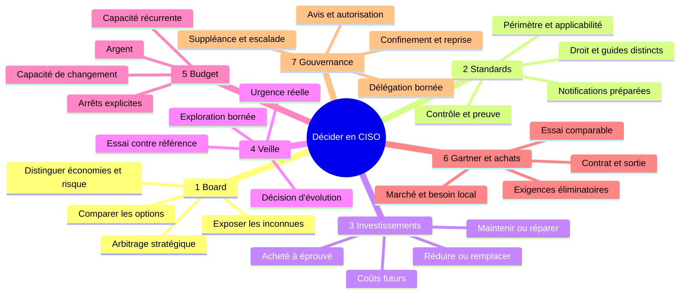
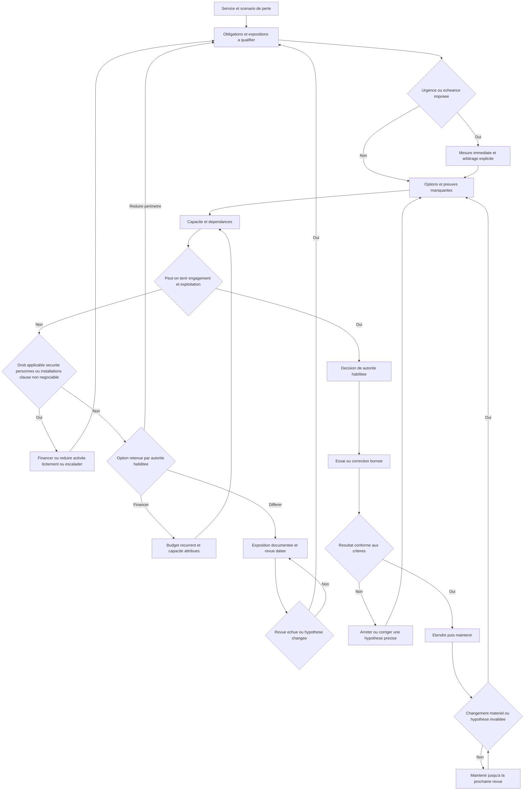

# Mind map — La sécurité n’est pas un concours de slides

- **Centre : décider sous contraintes, pas collectionner des solutions.**
- **Lecture :** chaque branche possède son propre objet ; les flèches relient les décisions, elles n’imposent pas l’ordre des achats.

## Les tensions à garder visibles pendant la rédaction

- **1 ↔ 5 :** une décision de financement n’invente pas la capacité d’exploitation.
- **2 ↔ 5 :** une contrainte budgétaire ne rend pas une obligation facultative ; les options doivent traiter le conflit.
- **3 ↔ 6 :** le meilleur nouveau produit peut ne pas justifier une migration ; l’existant ne bénéficie pas d’une rente éternelle.
- **4 ↔ 6 :** l’expérience teste une hypothèse ; l’achat engage des coûts et une dépendance.
- **4 ↔ 7 :** déléguer une action à un agent ne supprime pas la question de l’autorité.
- **7 ↔ 1 :** la direction arbitre ; le fonctionnement quotidien ne doit pas attendre son prochain comité.
- **Tous ↔ roadmap :** une recommandation ne devient un chantier qu’avec une dépendance levée et une capacité attribuée.

## Carte de décision de la roadmap

## Angles morts à chercher, pas liste universelle d’achats

- **Chemin d’attaque :** exposition → identité humaine ou machine → droits → données ou service → conséquence.
- **Chemin de reprise :** administration de confiance → accès aux sauvegardes → restauration intègre → transaction métier → dépendances.
- **Chemin d’innovation :** problème → référence simple → essai → coût de supervision → autorisation → arrêt possible.
- **Chemin d’achat :** besoin → options admissibles → preuve locale → engagement contractuel → exploitation → sortie.
- **Chemin de gouvernance :** expertise → décision habilitée → exécution → vérification → recours.
