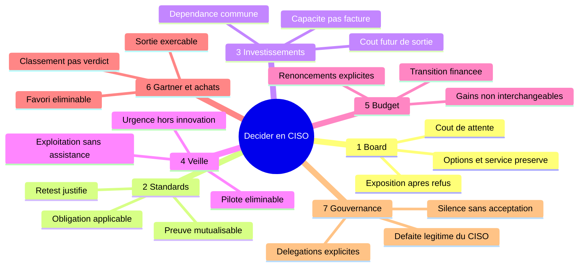
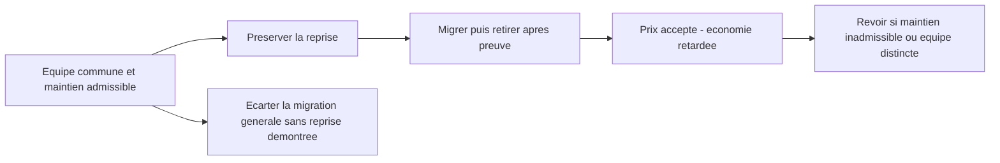

<!-- Source : base-auteur.md -->

# La sécurité n’est pas un concours de slides

Base auteur développée. Trois axes par chapitre ; les sous-points donnent de la matière à écrire, pas une prose à recopier. Les cas publics sont sourcés ; les choix et les formules proposés sont des angles éditoriaux, pas des conclusions des sources. Détail des preuves et limites : [registre de sources](../../research/developpement-sources.md) et [lecture critique de BRKSEC-1785](../../research/brksec-1785.md). Les références Cisco utilisent les pages physiques du PDF, pas une numérotation de slides supposée.

## Introduction — Acheter moins de certitudes

Menace, obligation et offre commerciale ne sont pas synonymes. Partir de cette confusion : une menace justifie une analyse, une obligation impose de qualifier son champ, une offre doit encore prouver son utilité. Le CISO ne promet pas l’immunité ; il rend les choix possibles, y compris ceux qui déplaisent à la sécurité.

## 1 — Board : obtenir une décision, pas une bonne note

- **Présenter un choix, pas un catalogue.**
  - Développer le passage du produit au service : non pas « acheter une sauvegarde », mais pouvoir rouvrir l’activité avec ses données, ses accès et ses applications. Comparer les pertes plausibles et les moyens requis, sans déguiser une hypothèse en prévision.
  - Ici, raconter la British Library après l’attaque d’octobre 2023 : des copies des collections numériques existaient, mais l’infrastructure viable pour les restaurer manquait. Le rapport du 8 mars 2024 distingue clairement conservation des données et retour du service.[1](../../research/developpement-sources.md#source-1)
  - Faire apparaître le choix : financer la chaîne de reprise plutôt qu’un stockage supplémentaire si le blocage est applicatif. Formule possible : « Le board n’achète pas des copies. Il achète une chance de rouvrir. »
- **Attendre a aussi un prix.**
  - Une étude peut éviter une mauvaise décision ; elle peut aussi consommer le créneau de migration ou prolonger une exposition. Décrire les deux coûts, au lieu d’opposer courage et prudence.
  - Ici, développer l’information décisive : si un test de restauration peut changer l’ordre des investissements, le financer ; si son résultat arrivera après l’échéance de choix, décider avec l’incertitude explicitée.
  - Le report doit avoir une condition de sortie observable. « Nous attendons » n’est pas une stratégie si personne ne sait quel résultat permettra de cesser d’attendre.
- **Un budget refusé laisse une exposition.**
  - Distinguer refus de dépense et acceptation du risque : le premier ne désigne ni le décideur habilité pour le second, ni les services qu’il accepte de dégrader.
  - Développer la contre-proposition : préserver la reprise, différer une extension, réduire le périmètre couvert. Nommer ce que chaque option laisse sans protection supplémentaire et qui doit l’arbitrer.
  - Ne pas transformer le désaccord en menace. Si l’exposition dépasse les délégations ou l’appétence, la remonter ; sinon, exécuter le choix valide sans continuer à vendre l’option refusée.

## 2 — Standards : prouver utile, pas produire plus

- **Tout référentiel n’est pas une obligation.**
  - Avant de chiffrer un programme, séparer exigence légale, engagement contractuel, certification recherchée et guide volontaire. Une même recommandation peut devenir contractuellement importante sans devenir, pour autant, une loi universelle.
  - Ici, utiliser un contraste vérifiable : dans sa publication du 26 juin 2025, l’ENISA précise que son guide d’implémentation NIS2 n’est pas juridiquement contraignant et invite les entreprises concernées à consulter leurs autorités nationales.[3](../../research/developpement-sources.md#source-3)
  - Angle à développer : qualifier le texte, l’entité et le périmètre avec le juridique avant d’acheter la conformité. Le guide peut être excellent ; ce n’est pas une raison pour lui attribuer une force qu’il ne revendique pas.
- **Mutualiser les preuves, pas inventer leur équivalence.**
  - Partir d’un rapport de revue des accès : il peut servir plusieurs demandes si les comptes, la période et les contrôles observés correspondent. Un fichier commun réduit les copies ; il ne résout pas un écart de périmètre.
  - Ici, développer la différence entre « la procédure existe » et « les droits ont effectivement été retirés ». Le même document ne prouve pas automatiquement la conception du contrôle et son fonctionnement.
  - Le choix utile : compléter seulement la preuve manquante plutôt que refaire tout l’audit. Accepter toutefois une collecte distincte lorsque l’exigence, la population ou l’indépendance du contrôle diffère réellement.
- **Une preuve récente peut déjà être caduque.**
  - Expliquer le mécanisme : une migration d’identité peut invalider une revue des privilèges ; une nouvelle dépendance peut invalider un test de reprise pourtant récent. C’est la conclusion qui vieillit, pas seulement le fichier.
  - Ici, construire le passage autour du changement intervenu depuis le test, puis du contrôle ciblé qui permet de retrouver confiance. Ne pas réclamer une campagne entière pour chaque modification mineure.
  - Formule possible : « Une capture datée d’hier peut raconter le système d’avant-hier. » La preuve utile permet de décider aujourd’hui, pas seulement de fermer une demande documentaire.

## 3 — Investissements : sauver la capacité, pas l’achat

- **La facture ne prouve pas la protection.**
  - Suivre une capacité jusqu’à son usage : les journaux arrivent-ils, l’alerte est-elle comprise, quelqu’un peut-il agir ? Une licence activée n’efface ni un connecteur cassé ni une réponse sans responsable.
  - Ici, partir du retrait des équipements hors support recommandé par Cisco : inventaire, exposition Internet d’abord, puis priorités métier, avec précautions propres à l’OT.[Cisco, p. 14–17](../../research/brksec-1785.md#maintenabilite) Angle auteur : acheter la capacité de rester maintenable, pas seulement une nouvelle boîte.
  - Contradiction : retirer brutalement un équipement industriel peut dégrader le service qu’il protège. Développer le maintien borné avec isolement éprouvé et sortie préparée ; l’impossibilité de contenir l’exposition peut rendre le remplacement prioritaire.
- **Sortir peut coûter plus que rester.**
  - Comparer les dépenses et les risques futurs : reprise des règles, export de l’historique, formation, exploitation en parallèle et contrôles temporairement moins efficaces. L’argent déjà dépensé n’est pas un argument pour renouveler.
  - Ici, développer le maintien temporaire assumé : rester peut être rationnel si une sortie précipitée casse la détection. Mais préciser ce qui rendra la sortie praticable, faute de quoi le temporaire devient une rente.
  - Faire changer la recommandation si le fournisseur ne peut plus satisfaire une exigence indispensable. Une transition coûteuse peut alors être nécessaire, même sans économie promise.
- **Plusieurs fournisseurs peuvent tomber ensemble.**
  - Compter les dépendances plutôt que les logos : identité, hébergement, réseau, administration. Deux contrats ne créent pas deux chemins de secours si le même service est nécessaire pour les utiliser.
  - Ici, raconter la panne Cloudflare des 2–4 novembre 2023 : malgré une architecture répartie sur trois centres, des dépendances non évidentes ont rendu certains systèmes critiques indisponibles. Les services réseau et de sécurité continuaient ; le plan de contrôle et l’analytique étaient touchés. Ce cas concerne un seul fournisseur, pas une panne multi-fournisseurs : il illustre le mécanisme de dépendance, que l’on propose ensuite de rechercher entre contrats.[2](../../research/developpement-sources.md#source-2)
  - Confronter ce cas au schéma Cisco : des points d’application distribués partagent un plan de contrôle.[Cisco, p. 26](../../research/brksec-1785.md#dependances) Angle de test proposé, pas panne démontrée : sans ce plan, quelles règles restent appliquées, lesquelles peuvent encore changer ? Consolider si le gain d’exploitation justifie cette dépendance, pas parce que les icônes sont dispersées.

## 4 — Veille : apprendre quelque chose ou arrêter

- **Une alerte urgente n’est pas un sujet d’innovation.**
  - Traiter l’exposition sans attendre un achat d’innovation. Cisco présente Live Protect comme une protection temporaire ciblée, pas un correctif.[Cisco, p. 34–37](../../research/brksec-1785.md#contenir) Angle auteur : contenir peut acheter du temps si le chemin couvert est vérifié et la correction reste la sortie ; sans couverture démontrée, réarbitrer l’urgence avec l’autorité habilitée.
  - Ici, placer un chiffre précisément borné : le DBIR 2025 situe l’exploitation de vulnérabilités à 20 % des violations de données analysées. Le corpus comprend 22 052 incidents, dont 12 195 violations de données confirmées ; la période de collecte des incidents est du 1er novembre 2023 au 31 octobre 2024.[5](../../research/developpement-sources.md#source-5)
  - Ne pas convertir ce chiffre en probabilité locale. S’en servir pour ouvrir la question « sommes-nous exposés ? », puis revenir aux actifs et protections réels. Une tendance ne remplace pas un diagnostic.
- **Un pilote doit pouvoir perdre.**
  - Définir le résultat qui rendrait préférable l’existant ou une option plus simple. Pour une aide à l’analyse d’alertes, comparer la qualité de la décision finale, pas seulement la vitesse de rédaction du résumé.
  - Ici, reprendre l’ambition « résultats vérifiables » de Foundry, présentée par Cisco, sans reprendre sa promesse d’efficacité.[Cisco, p. 49–51](../../research/brksec-1785.md#pilote) Essai proposé : pour détecter des vulnérabilités, demander une preuve reproductible sur le périmètre autorisé, puis compter relectures et faux positifs. Plus de découvertes annoncées peut signifier plus de travail, pas plus de protection.
  - Préserver la contradiction : une solution moins rapide peut rester préférable si elle réduit une erreur grave. Décider de cette priorité avant de voir les résultats, pas pour sauver le favori après coup.
- **Une démo réussie ne finance pas l’exploitation.**
  - Retirer progressivement l’assistance temporaire du fournisseur : qui maintient les connecteurs, traite les incidents et adapte les règles ? L’essai doit révéler le travail qui reviendra à l’équipe.
  - Ici, développer un essai d’automatisation d’abord sans action irréversible : observer les propositions, puis n’autoriser que les actions bornées. Arrêter l’assistant ne garantit pas l’annulation d’une action déjà transmise.
  - Accepter de ne pas industrialiser une réussite technique si personne ne peut l’exploiter. « Cela marche » et « nous pouvons le faire fonctionner » sont deux conclusions différentes.

## 5 — Budget : financer le passage, pas seulement la cible

- **Une économie future ne paie pas la transition.**
  - Montrer les dépenses qui se superposent : ancien contrat, nouvelle plateforme, migration des données, formation et retour arrière. Présenter le moment où l’ancien coût disparaît, pas seulement la facture cible.
  - Ici, partir de la cadence de versions durcies annoncée par Cisco, qui prévoit aussi des corrections hors cycle.[Cisco, p. 40–43](../../research/brksec-1785.md#cadence) Angle auteur : financer les heures récurrentes de test, bascule et retour arrière, pas seulement la migration initiale. Une cadence fournisseur ne réserve pas la capacité de l’équipe ; préserver aussi une voie urgente.
  - Arbitrage proposé : réduire la première vague pour conserver une reprise praticable, quitte à retarder l’économie. Inverser ce choix si le maintien devient inadmissible ou si une capacité de transition distincte est réellement disponible.
- **Moins de licences ne signifie pas moins de travail.**
  - Distinguer trois résultats : une dépense supprimée, une tâche supprimée et du temps réaffectable. Ils ne coïncident pas si les contrats continuent ou si le travail revient sous forme de maintenance interne.
  - Ici, développer le cas de l’automatisation sans inventer de gains : décrire la tâche retirée, puis la validation, les exceptions et l’entretien ajoutés. La preuve attendue est le travail net que l’équipe peut effectivement cesser.
  - Contrepoint : une petite réduction de charge peut être précieuse sans permettre de supprimer un poste. La présenter comme une capacité de réponse retrouvée, pas comme une économie de trésorerie fictive.
- **Sans moyens supplémentaires, quelque chose doit céder.**
  - Faire apparaître l’activité sacrifiée : réduire une couverture, reporter une migration ou arrêter un service. « Absorber » masque l’arbitrage lorsque toutes les personnes sont déjà engagées.
  - Ici, développer une décision que le responsable métier peut prendre : préserver le service essentiel et différer une amélioration réversible, plutôt que répartir silencieusement la dégradation partout.
  - Ne pas laisser croire qu’un arbitrage budgétaire dispense d’une obligation. Si les moyens manquent pour la satisfaire, escalader vers l’autorité compétente ; ne pas promettre une conformité que le plan ne permet pas d’atteindre.

## 6 — Gartner et achats : le favori peut-il perdre ?

- **Le classement ouvre la recherche, il ne conclut pas l’achat.**
  - Utilité légitime : découvrir des acteurs, structurer une comparaison. Puis passer de « qui domine le marché ? » à « qui répond à notre besoin avec notre exploitation ? ».
  - Ici, opposer une feuille de route à une capacité achetable : Cisco annonce Live Protect sans surcoût, mais distingue disponibilité annoncée et plateformes futures, avec réserve de livraison.[Cisco, p. 38](../../research/brksec-1785.md#achat) Angle auteur : exiger la preuve sur la version et le matériel visés, puis chiffrer l’exploitation. Sans surcoût ne signifie ni couverture locale ni coût total nul.
  - Ne pas remplacer le culte du leader par celui du challenger. Le leader peut gagner, notamment si son intégration et son support réduisent réellement le travail ; il doit simplement pouvoir perdre sur une exigence indispensable.
- **Une compétition sans élimination possible est un décor.**
  - Montrer comment le résultat peut être verrouillé avant les essais : contrat groupe, compétence rare déjà disponible ou calendrier incompatible avec une migration. La contrainte peut être valable ; la cacher fausse la discussion.
  - Ici, développer un critère éliminatoire annoncé avant le test : si l’export exploitable des données est indispensable, son absence ne se compense pas par une belle interface. Une révision de cette exigence suppose une décision explicite de l’autorité habilitée, et seulement si le droit et les engagements applicables le permettent ; un échec au test ne suffit pas à la rendre facultative.
  - Quand une seule offre reste réaliste, faire approuver un choix contraint et ses limites. Ne pas fabriquer trois candidats et une matrice flatteuse pour donner une apparence d’ouverture.
- **La dépendance peut réduire le levier de négociation.**
  - Déplacer l’attention du rabais vers la sortie : quels droits sur les données, quels formats disponibles, quel délai de restitution et quelle assistance de migration ? Les conditions contractuelles et la faisabilité technique doivent se rejoindre.
  - Ici, développer la différence entre « export autorisé » et « export réutilisable » : conserver événements et règles ne suffit pas si leur sens disparaît hors de la plateforme. Éprouver un échantillon représentatif avant de promettre la réversibilité.
  - Accepter une dépendance consciente si sa valeur justifie le coût futur ; éviter d’acheter une fausse indépendance plus coûteuse à maintenir que le risque qu’elle est censée réduire.

## 7 — Gouvernance : décider sans tout signer

- **L’avis du CISO n’est pas une autorisation universelle.**
  - Séparer l’expertise sur le risque, la décision de l’accepter dans une délégation et l’autorité d’exécuter une action. Un avis favorable sur un contrôle n’autorise pas à lui seul la mise en production d’un service.
  - Ici, prolonger le propos de Cisco sur les scripts devenus agents d’opérations IT et sur l’inventaire de leurs composants et accès.[Cisco, p. 44–47](../../research/brksec-1785.md#agents) Angle auteur : autoriser l’analyse n’autorise pas la modification réseau ; borner les identifiants du connecteur et vérifier leur révocation. Arrêter l’agent ne suffit pas à retirer les pouvoirs déjà transmis.
  - Ne pas confondre visibilité du board et transfert de responsabilité. L’enjeu éditorial est de montrer qui peut décider quoi, sans transformer chaque exception en séance du conseil.
- **Le CISO peut perdre un arbitrage légitime.**
  - Donner de la place à l’autre intérêt : disponibilité du service, engagement client, capacité de changement. Le désaccord ne prouve ni l’incompétence du décideur ni l’excès de prudence du CISO.
  - Ici, développer l’après-décision : conserver la recommandation écartée, les hypothèses du choix et les conditions de réexamen, puis contribuer à l’exécution. La trace sert à piloter, pas à préparer un « je vous l’avais dit ».
  - Une délégation dépassée ou une obligation non satisfaite change la situation : ce n’est plus simplement perdre un arbitrage valide. Escalader ce défaut plutôt que prétendre pouvoir tout arrêter personnellement.
- **Le silence ne vaut pas acceptation.**
  - L’absence de réponse laisse une décision en suspens. Préparer le suppléant, le canal joignable hors du système principal et les mesures conservatoires déjà autorisées ; l’urgence ne crée pas une délégation.
  - Ici, revenir brièvement à la British Library : le 28 octobre 2023, son équipe de crise Gold s’est réunie à 10 heures par appel vidéo WhatsApp en l’absence de courrier électronique. Le détail montre l’utilité d’un canal de secours, pas une recommandation universelle de cet outil.[1](../../research/developpement-sources.md#source-1)
  - Développer la frontière : une restriction réversible prévue par le mandat n’équivaut pas à l’arrêt général d’une activité. Si aucune autorité ne répond, documenter l’escalade et rester dans les pouvoirs effectivement accordés.

## Conclusion — Assumer ce qui attend

Revenir à un choix simple : lorsque la même équipe doit sécuriser la reprise et migrer, préserver d’abord la reprise si le maintien reste admissible. L’économie retardée est alors assumée, pas oubliée. Changer de trajectoire si le maintien devient inadmissible ou si une équipe distincte devient disponible. La maturité ne consiste pas à tout lancer : elle consiste à pouvoir expliquer ce qui attend, pourquoi, et ce qui ferait changer la décision.

---

<!-- Source : mind-map.md -->

# Sept situations, trois arguments chacune

Carte d’écriture, pas procédure de crise. [Base auteur](../../base-auteur.md).

## Conclusion en une carte

---

<!-- Source : research/brksec-1785.md -->

# BRKSEC-1785 — idées retenues, preuves et limites

Consulté le 23 novembre 2026. Source unique de cette passe : [1], distincte des identifiants du [registre de développement](../../research/developpement-sources.md). Les liens « Cisco, p. … » de la base renvoient aux rubriques ci-dessous, puis à la page exacte du PDF.

## Identité et méthode

**Titre affiché :** *Final Frontier - Security Playbook for the AI Era*. **Intervenants affichés :** Jatin Sachdeva et Mike McPhee, tous deux Principal Solutions Engineer (couverture, page PDF 1). Session **BRKSEC-1785**, Cisco Live APJC 2026. Le support porte © 2026 ; la page 2 annonce une modération Webex jusqu’au 19 novembre 2026, ce qui ne prouve pas le jour de présentation. Métadonnée de création : 10 novembre 2026 ; ce n’est pas une date de conférence. Le champ technique « author » du PDF indique Natalie Bain : ne pas le confondre avec les intervenants crédités.

**Numérotation :** 62 pages PDF, couverture comprise. Ici, « p. » désigne toujours l’index physique PDF, base 1, ciblé par `#page=N`, et non un numéro de diapositive imprimé. Les diapositives retenues n’affichent pas de numéro de slide distinct. La page PDF 53 porte toutefois « 58 » : aucun décalage uniforme n’a été supposé. Les titres de diapositives ci-dessous permettent de retrouver le passage même si le lecteur ignore les fragments de lien.

**Lecture :** extraction et lecture du texte des 62 pages, y compris ressources et clôture ; inspection visuelle des pages 1, 15, 26, 29, 34, 38, 51 et 53. Le graphique circulaire des pages 15–40 est illustratif : ni dénominateur ni mesure d’efficacité ne permet d’en tirer des pourcentages. Copie PDF, extraction intégrale, images et ledger de travail conservés hors dépôt, dans `/data/books/ciso-sans-boule-de-cristal/cisco-brksec-1785/`.

**Statut des preuves :** source primaire pour ce que Cisco recommande ou annonce ; pas validation indépendante de ses produits. Les conséquences CISO ci-dessous sont des interprétations éditoriales. Aucun nouveau taux, incident, résultat de laboratoire ni gain économique n’est introduit. Les sources historiques de la base sont conservées, pas présentées comme nouvellement auditées. La recherche telco demandée séparément n’est pas encore intégrée à cette passe.

## 1. Acheter la maintenabilité — chapitre 3, axe 1

**Source :** « Recommended Model », « Step 1: Retire LDoS », « Why Technical Debt Can No Longer Wait », [pages PDF 14–17](https://www.ciscolive.com/c/dam/r/ciscolive/apjc/docs/2026/pdf/BRKSEC-1785.pdf#page=14).[1]

> Remove what cannot be patched, supported, or upgraded.

Cisco recommande inventaire, priorité aux systèmes exposés à Internet, puis priorités métier, avec considérations particulières pour infrastructures critiques et OT (p. 16). **Interprétation retenue :** faire du renouvellement une décision sur la capacité de corriger et maintenir, pas sur l’âge seul. **Limite :** le support ne démontre pas qu’un retrait immédiat soit sûr ; maintien isolé et condition de sortie sont des propositions auteur, pas une garantie d’efficacité. Remplace une consigne générique sur le renouvellement.

## 2. Distribuer le contrôle ne supprime pas la dépendance — chapitre 3, axe 3

**Source :** « The new Zero Trust imperative is mesh of enforcers! », [page PDF 26](https://www.ciscolive.com/c/dam/r/ciscolive/apjc/docs/2026/pdf/BRKSEC-1785.pdf#page=26) ; illustration de politique d’accès d’un agent, p. 29.[1]

> Common Control Plane

Le schéma distingue décision de politique et points d’application : pare-feu, SSE, agents, CNI et groupes de sécurité cloud. **Interprétation retenue :** tester règles conservées et capacité de changement quand la commande commune manque. **Limite :** le schéma ne décrit pas le comportement réel en panne et n’établit ni défaillance ni point unique de panne d’un produit. La comparaison avec le cas Cloudflare reste une question à éprouver, pas un incident commun. Remplace une conclusion générale sur la consolidation.

## 3. Acheter du temps, pas effacer la dette — chapitre 4, axe 1

**Source :** « Step 4: Compensating Controls », p. 32 ; « Step 5: Strategically Placed Live Protect Shields », p. 34 ; « A Runtime Shield Embedded in the Network OS », [page PDF 35](https://www.ciscolive.com/c/dam/r/ciscolive/apjc/docs/2026/pdf/BRKSEC-1785.pdf#page=35) ; cycle de retrait p. 37 ; correctifs p. 40.[1]

> Not a patch — a shield

Cisco borne les types de vulnérabilités couverts, présente une protection ciblée et temporaire, puis un retrait après correction. **Interprétation retenue :** ne différer la correction que si la couverture du chemin exploitable est démontrée ; sinon réarbitrer. **Limite :** « Zero disruption » et absence d’effet sur CPU/mémoire/latence (p. 35) sont des promesses fournisseur, pas des résultats vérifiés ici. Aucune durée universelle de report n’est prescrite.

## 4. Mesurer une conclusion vérifiable — chapitre 4, axe 2

**Source :** « Foundry Security Spec », [page PDF 49](https://www.ciscolive.com/c/dam/r/ciscolive/apjc/docs/2026/pdf/BRKSEC-1785.pdf#page=49) ; chaîne développement-test, p. 51.[1]

> From noisy alerts to verifiable security findings

**Interprétation retenue :** faire porter le pilote sur la reproductibilité autorisée et le travail net de validation, non sur le volume d’alertes. **Limite :** le support énonce une ambition, pas un benchmark. L’efficacité « comparable » des SLM Antares et les gains de Foundry (p. 51) ne sont pas repris. Remplace une formule générale sur le travail déplacé par un objet de test, sans ajouter de framework.

## 5. Financer une capacité récurrente de changement — chapitre 5, axe 1

**Source :** « Step 6: Fix (Patch, Update, etc.) », p. 40 ; « Consolidated Disclosure Model », p. 42 ; « Hardening our own systems », [page PDF 43](https://www.ciscolive.com/c/dam/r/ciscolive/apjc/docs/2026/pdf/BRKSEC-1785.pdf#page=43).[1]

> Note: Critical issues are addressed out of cycle, as needed

Cisco annonce une cadence de divulgations et des versions durcies, sans exclure les correctifs urgents. **Interprétation retenue :** financer essais, bascule et retour arrière au-delà de la migration initiale ; préserver la voie urgente. **Limite :** cadence annoncée par Cisco, pas obligation générale ni calendrier opérationnel vérifié. Le nombre de CVE clôturées ne devient pas une mesure de sécurité. Remplace une répétition sur les heures de transition.

## 6. Une roadmap n’est pas une capacité achetable — chapitre 6, axe 1

**Source :** limites de couverture p. 34 ; « Live Protect will be available across select Cisco platforms at zero additional cost », [page PDF 38](https://www.ciscolive.com/c/dam/r/ciscolive/apjc/docs/2026/pdf/BRKSEC-1785.pdf#page=38).[1]

> when-and-if-available basis

La frise sépare « Available Today », trimestres annoncés et « Future » ; elle réserve les délais et la livraison. **Interprétation retenue :** vérifier version, matériel et charge d’exploitation, plutôt que transformer l’annonce sans surcoût en coût total nul. **Limite :** aucune disponibilité actuelle ni universalité de couverture certifiée ici. Remplace des critères génériques de comparaison, sans recommander un fournisseur.

## 7. Gouverner les pouvoirs des agents d’exploitation — chapitre 7, axe 1

**Source :** « Step 7 – Yesterday’s scripts are today’s agents », [page PDF 44](https://www.ciscolive.com/c/dam/r/ciscolive/apjc/docs/2026/pdf/BRKSEC-1785.pdf#page=44) ; actifs, accès et composants IA, p. 45–47.[1]

> Yesterday’s scripts are today’s agents

Cisco attire l’attention sur l’IA dans les opérations IT, les services tiers et l’inventaire des modèles, agents, outils et MCP. **Interprétation retenue :** distinguer autorisation d’analyse et de modification, limiter les identifiants des connecteurs et vérifier la révocation. **Limite :** les détails de délégation et révocation sont notre prolongement, pas une procédure démontrée par le support. Aucun agent de l’auteur ni incident client n’est inventé.

## Pourquoi ne pas tout reprendre ?

- **Pages 5–9 : chiffres d’urgence omis.** « 8 hours », part de matériel vieillissant, vulnérabilités visant la fin de vie et délai médian de correction : populations, méthodes et comparabilité non vérifiées aux sources originales dans cette passe. Le support cite d’ailleurs le même intitulé de billet avec des dates différentes p. 5 et p. 43. Ces chiffres ne deviennent ni faits du livre ni probabilités locales.
- **Pages 10–14 : conserver l’équilibre, pas importer le slogan.** Fondamentaux et défense adaptative nourrissent la maintenabilité ; « machine speed » et « post-Mythos » ne constituent pas une preuve causale à ajouter au livre.
- **Pages 18–31, 45–54 : pas de catalogue de produits.** Retenir le mécanisme de dépendance et les pouvoirs des agents ; omettre listes de plateformes, promesses d’intégration et architecture à acheter. Les illustrations ne sont pas des incidents observés.
- **Pages 49–51 : pas de supériorité de modèle affirmée.** Le pilote reste éliminable ; aucune validation externe de Foundry, CodeGuard ou Antares n’est simulée.
- **Pages 55–62 : synthèse, ressources et clôture lues.** Les liens de ressources sont des pistes, non des sources supplémentaires réputées consultées. Ni cadre supplémentaire ni développement forcé des chapitres 1 et 2 : leurs arbitrages sont déjà distincts et mieux étayés par les cas conservés.

## Sources

[1] https://www.ciscolive.com/c/dam/r/ciscolive/apjc/docs/2026/pdf/BRKSEC-1785.pdf

---

<!-- Source : research/developpement-sources.md -->

# Sources et limites — base auteur développée

Consultation : 22 novembre 2026. Cas historiques choisis pour leur mécanisme, pas présentés comme l’actualité la plus récente. Les identifiants ci-dessous proviennent du ledger local [ledger de développement](../../research/developpement-ledger.json), distinct du registre historique du dépôt. La liste des liens est générée en fin de fichier.

## [1] British Library — retour d’expérience du 8 mars 2024

**Document primaire :** récit institutionnel de l’attaque du 28 octobre 2023, et de la reprise dans l’état connu au 8 mars 2024. Corps du PDF récupéré et lu ; copie de travail `page1.pdf`, extraction `page1.txt`.

**Affirmations utilisées :** chapitre 1, des copies des collections numériques existaient mais l’absence d’infrastructure viable freinait la restauration (Executive Summary, p. 2). Chapitre 7, réunion Gold à 10 heures par WhatsApp vidéo en l’absence de courrier électronique le 28 octobre 2023 (section Causality, p. 4).

**Courts extraits vérifiés :**

> we have been hampered by the lack of viable infrastructure on which to restore it.

> convening at 10:00 by WhatsApp video call in the absence of email.

**Limites :** compte rendu de l’organisation touchée, pas expertise indépendante exhaustive. Ne prouve ni un délai de reprise universel ni l’inutilité des sauvegardes. Ne pas transformer le canal de crise utilisé en recommandation générale de WhatsApp. Le point d’entrée exact de l’attaque demeure incertain dans le rapport ; aucun récit de compromission certaine n’a été ajouté.

**Angle auteur proposé :** financer le retour du service et préparer une autorité joignable hors du système habituel. Ce sont des recommandations tirées du cas, non des effets mesurés.

## [2] Cloudflare — panne du plan de contrôle et de l’analytique, novembre 2023

**Document primaire :** billet de Matthew Prince, « Post mortem on the Cloudflare Control Plane and Analytics Outage ». Incident décrit du 2 novembre au 4 novembre 2023. HTML récupéré directement ; texte conservé dans `page2.txt`.

**Affirmations utilisées :** chapitre 3, architecture du plan de contrôle et de l’analytique sur trois centres de données en Oregon ; dépendances non évidentes de certains systèmes critiques ; maintien des services réseau et de sécurité. Passages : introduction et « Intended Design ».

**Courts extraits vérifiés :**

> some critical systems had non-obvious dependencies that made them unavailable.

> Throughout the incident, Cloudflare's network and security services continued to work as expected.

**Limites :** post-mortem du fournisseur ; ce n’est ni une cyberattaque ni la preuve que trois fournisseurs différents sont tombés. Certains clients ne pouvaient plus modifier des services, mais le trafic continuait. La généralisation aux dépendances communes entre contrats est un angle de raisonnement, pas une observation de ce cas. Extraction HTML artisanale imparfaite : titre, introduction et architecture lus ; la totalité des détails tardifs du billet n’est pas certifiée par cette extraction. Aucune affirmation ne repose sur ces passages tardifs.

**Angle auteur proposé :** tester l’indépendance effective des chemins de secours plutôt que compter les logos.

## [3] ENISA — publication du 26 juin 2025

**Document primaire :** « Supporting NIS2 implementation through actionable guidance », page institutionnelle récupérée directement ; `page3.txt`.

**Affirmations utilisées :** chapitre 2, le guide n’est pas juridiquement contraignant ; les entreprises concernées sont invitées à consulter leurs autorités nationales pour connaître leurs obligations. Paragraphe suivant la liste des fournisseurs dans le périmètre.

**Court extrait vérifié :**

> The implementation guidance is not a legally binding document

**Limites :** cette phrase porte sur le guide, pas sur la directive NIS2 ni sur le règlement d’exécution. Aucun état exhaustif de la transposition française n’est affirmé. L’utilité contractuelle éventuelle d’un référentiel est un raisonnement général à valider pour chaque contrat.

## [5] Verizon — DBIR 2025

**Document primaire :** rapport 2025, PDF récupéré directement ; `page5.pdf` et extraction `page5.txt`. Sections lues pour les affirmations : Introduction, Summary of findings, Results and analysis, Appendix A: Methodology. L’extraction de certaines pages en colonnes entrelace les phrases ; les passages de statistique utilisés restent lisibles.

**Affirmations utilisées :** chapitre 4, exploitation de vulnérabilités présente dans 20 % de toutes les violations analysées, formulation explicite dans Results and analysis. Corpus global : 22 052 incidents, dont 12 195 violations de données confirmées (Introduction). Fenêtre de collecte annoncée : 1er novembre 2023–31 octobre 2024 (méthodologie). Les graphiques de tendance mobilisent aussi des données antérieures.

**Courts extraits vérifiés :**

> But that uncertainty doesn’t take away from exploitation of vulnerabilities being present in 20% of all breaches we analyzed

> Thus, the incidents described in this report took place between Nov 1, 2023, and Oct 31, 2024.

**Limites :** corpus de cas fournis par Verizon, contributeurs et divulgations publiques, pas échantillon aléatoire de toutes les entreprises. La figure des vecteurs initiaux exclut Error/Misuse et affiche son propre dénominateur ; le texte auteur s’appuie sur l’énoncé explicite concernant l’ensemble des violations, pas sur un recalcul de cette figure. Le chiffre n’est ni un taux annuel de victimes ni une probabilité de compromission de l’organisation lectrice. Édition historique 2025, pas prétention d’utiliser la dernière édition disponible.

## Sources non retenues et incidents de récupération

Le ledger initial du dépôt a été consulté comme piste, non comme substitut de lecture des nouvelles preuves. L’extracteur web configuré refuse l’extraction ; récupération HTTP directe utilisée. `bs4` et `pdftotext` absents : extraction HTML simple et outil `read_file` pour les PDF, sans installation ni changement de configuration.

La page Gartner `https://www.gartner.com/en/research/methodologies/magic-quadrants` a renvoyé HTTP 403. Elle conserve l’identifiant technique [4] dans le ledger de travail mais n’est pas citée dans le manuscrit ni dans la liste des sources utilisées. L’attribution « Gartner le présente comme un point de départ » de l’ancienne base n’a donc pas été reproduite comme fait nouvellement vérifié : l’axe est conservé comme recommandation éditoriale. Pas de chiffre, citation ni prétendue lecture inventés pour combler ce blocage.

## Périmètre de publication

Publier au besoin les trois fichiers éditoriaux, pas les PDF, extractions complètes ou logs de récupération. Les extraits courts ci-dessus servent à contrôler les affirmations. Les fichiers bruts sont des pièces de travail ; les conserver hors du dépôt public. La validation automatique des références ne vaut pas expertise indépendante du fond.

## Sources

[1] https://www.bl.uk/home/british-library-cyber-incident-review-8-march-2024.pdf
[2] https://blog.cloudflare.com/post-mortem-on-cloudflare-control-plane-and-analytics-outage
[3] https://www.enisa.europa.eu/news/supporting-nis2-implementation-through-actionable-guidance
[5] https://www.verizon.com/business/resources/reports/2025-dbir-data-breach-investigations-report.pdf
