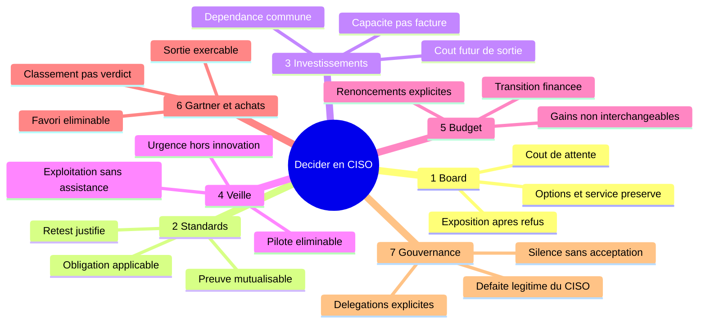
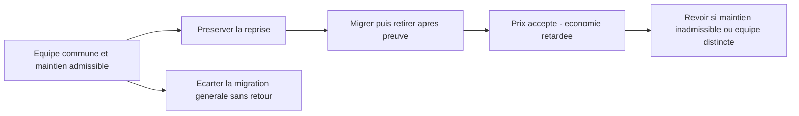

# La sécurité n’est pas un concours de slides

Base auteur. Oussama rédige le livre : trois arguments par chapitre, pas sept méthodes de plus.

## Introduction — Acheter moins de certitudes

Menace, obligation et offre commerciale ne sont pas synonymes. Le rôle du CISO : choisir ce qui mérite les moyens, dire ce qui attend et reconnaître ce qui ferait changer d’avis.

## 1 — Board : obtenir une décision, pas une bonne note

- **Présenter un choix, pas un catalogue.** Comparer la perte plausible, le coût et le service préservé par chaque option, sans vendre l’immunité.
- **Attendre a aussi un prix.** Demander une étude seulement si son résultat peut encore changer la décision avant que l’option disparaisse.
- **Un budget refusé laisse une exposition.** Faire arbitrer ce qui reste couvert, ce qui attend et ce qui impose une remontée au-delà des délégations.

## 2 — Standards : prouver utile, pas produire plus

- **Tout référentiel n’est pas une obligation.** Qualifier le texte, l’entité et le périmètre avant de financer la conformité ; les distinctions juridiques restent en [annexe](annexe-juridique.md).
- **Mutualiser les preuves, pas inventer leur équivalence.** Réutiliser ce qui couvre réellement la même population, la même période et la même exigence.
- **Une preuve récente peut déjà être caduque.** Refaire le test si le changement invalide sa conclusion, pas pour rafraîchir une capture.

## 3 — Investissements : sauver la capacité, pas l’achat

- **La facture ne prouve pas la protection.** Renouveler pour une capacité exploitée et éprouvée, pas pour défendre la décision d’hier.
- **Sortir peut coûter plus que rester.** Comparer les coûts futurs et les contrôles perdus pendant la migration, sans compter l’argent déjà dépensé comme un bénéfice.
- **Plusieurs fournisseurs peuvent tomber ensemble.** Consolider si l’exploitation y gagne, mais éprouver ce qui reste utilisable sans leur dépendance commune.

## 4 — Veille : apprendre quelque chose ou arrêter

- **Une alerte urgente n’est pas un sujet d’innovation.** Traiter l’exposition avec les mesures autorisées sans attendre le prochain comité de veille.
- **Un pilote doit pouvoir perdre.** Fixer le résultat qui ferait préférer l’existant ou l’option plus simple, travail de vérification compris.
- **Une démo réussie ne finance pas l’exploitation.** Tester sans l’aide temporaire du fournisseur et borner les effets irréversibles avant le premier essai.

## 5 — Budget : financer le passage, pas seulement la cible

- **Une économie future ne paie pas la transition.** Chiffrer le chevauchement et obtenir la disponibilité des équipes avant d’engager la migration.
- **Moins de licences ne signifie pas moins de travail.** Distinguer facture supprimée, heures libérées et capacité réellement réaffectable.
- **Sans moyens supplémentaires, quelque chose doit céder.** Faire arbitrer l’arrêt, le report ou la réduction d’activité, sans promettre d’absorber une obligation à moyens constants.

## 6 — Gartner et achats : le favori peut-il perdre ?

- **Le classement ouvre la recherche, il ne conclut pas l’achat.** Gartner le présente comme un point de départ ; retenir l’offre adaptée au besoin local, leader ou non.[19](research/reperes-documentaires.md)
- **Une compétition sans élimination possible est un décor.** Si le choix est contraint, faire approuver ses limites plutôt que fabriquer la meilleure note.
- **Le pouvoir d’achat baisse après la signature.** Vérifier le droit de sortie, la réutilisation des données et la capacité de migration avant de consentir la dépendance.

## 7 — Gouvernance : décider sans tout signer

- **L’avis du CISO n’est pas une autorisation universelle.** Distinguer recommandation, acceptation du risque et pouvoir d’exécution dans des délégations explicites.
- **Le CISO peut perdre un arbitrage légitime.** Conserver le désaccord et exécuter la décision valide ; la rouvrir sur un fait nouveau, pas par veto de confort.
- **Le silence ne vaut pas acceptation.** Escalader vers le suppléant habilité et appliquer seulement les mesures conservatoires autorisées, sans déduire un pouvoir d’arrêt de l’urgence.

## Conclusion — Assumer ce qui attend

Si la même équipe doit sécuriser la reprise et migrer, préserver d’abord la reprise lorsque le maintien reste admissible. Accepter l’économie retardée plutôt qu’une migration générale sans retour démontré. Revoir ce choix si le maintien devient inadmissible ou si une équipe distincte devient disponible.

Les [sources et leurs limites](research/reperes-documentaires.md) restent hors du fil de lecture. Les cas vécus et leur développement appartiennent à l’auteur.

# Sept situations, trois arguments chacune

Carte d’écriture, pas procédure de crise. [Base auteur](base-auteur.md).

## Conclusion en une carte

# Auto-critique GPT — version concise

Modèle déclaré par le runtime : `gpt-6-astra`, fournisseur `openai-codex`. Auto-critique, pas revue indépendante.

L’ancienne revue GPT défendait les inversions et sept outils. Grok signalait déjà leur répétition. Pour la demande actuelle, je donne raison à Grok sur la coupe : supprimer les outils, conserver les choix incompatibles.

Le texte proposé tient trois arguments par chapitre. Il garde le coût de l’attente, les preuves invalidées, la dépendance commune, le pilote éliminable, la transition, le choix fournisseur contraint et la défaite légitime du CISO. Pas d’anecdote ni chiffre inventé.

Faiblesse : la compression réduit les conditions de réouverture et le détail des preuves. Je préfère ce sacrifice à des sous-bullets dissimulés. Le chapitre budget pourrait encore préciser quelle obligation rend le report inadmissible ; l’annexe conserve la qualification juridique. La formule sur le pouvoir après signature est une proposition d’argument, pas une loi empirique universelle.

À contredire par Grok : faut-il corriger une ambiguïté matérielle, ou cette prudence recréerait-elle le texte trop long ? Maximum trois corrections, sans nouveau dispositif. Sources conservées, non revérifiées sur le web pendant cette coupe.
